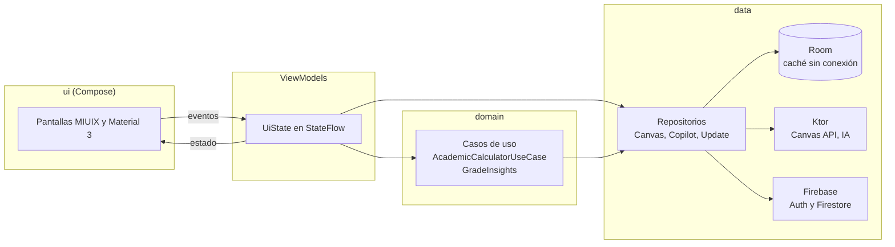

# NotiVas

NotiVas es una app para estudiantes de Tecsup. Se conecta a Canvas LMS y reúne en un solo lugar tus notas, tareas, foros, horario y avance de cada curso, con un simulador de notas y un Copiloto con IA que responde preguntas usando tus datos reales.

Está hecha con Kotlin Multiplatform y Compose Multiplatform. Android es la plataforma principal; el mismo código corre en la web (Wasm), en escritorio (JVM) y tiene el proyecto de iOS.

- Demo web: https://joxquin.github.io/NotiVas-KMP/
- APK: sección [Releases](https://github.com/Joxquin/NotiVas-KMP/releases)
- Política de privacidad: [PRIVACY.md](PRIVACY.md)

## Qué hace

| Área | Qué ve el estudiante |
|---|---|
| Inicio | Promedio general, cursos con su nota y estado, actividad reciente y accesos rápidos. |
| Curso | Avance, entregables, módulos de Canvas y ruta de aprendizaje. |
| Tareas | Consigna limpia, estado de entrega, borradores en Google Drive y una pre-revisión con IA antes de entregar. |
| Notas | Simulador por grupos de evaluación: qué nota necesitas para aprobar o llegar a tu meta. |
| Rendimiento | Promedio por curso y en riesgo, con la misma cifra en todas las pantallas. |
| Foros y horario | Debates del curso con su detalle y el horario semanal. |
| Copiloto IA | Chat que consulta tus notas y tareas con herramientas propias (ver abajo). |
| Ajustes | Tema Material 3 o MIUIX, colores dinámicos (Monet), idioma, notificaciones, token de Canvas y API key de la IA. |

## Semestre de prueba

En la pantalla de bienvenida, toca **Probar un semestre sin cuenta**. La demo usa tareas y notas ficticias. En la versión web, añade `?demo=1` a la dirección de NotiVas para entrar directamente.

1. Abre **Modo Rescate** y elige 30, 60 o 90 minutos. Ajusta la duración de cada pendiente para ver cuáles puedes terminar antes de su plazo.
2. Toca **Adelantar la entrega de Redes**. El **Radar de cambios** muestra el plazo anterior y el nuevo, y el plan se recalcula.
3. En **Simular una nota**, cambia la nota del informe para ver cómo varía el promedio proyectado.
4. Toca el **Informe de Redes** y abre **Entrega en equipo**. Edita los pasos de la consigna, asigna responsables y fechas, y revisa el texto antes de compartirlo.

## Arquitectura

La app sigue MVVM con flujo de datos en una sola dirección (UDF): la pantalla dibuja el estado que le da su ViewModel y le avisa de cada acción; el ViewModel pide los datos a repositorios y casos de uso, y publica un nuevo estado.



- `shared/src/commonMain/kotlin/me/joxquin/notivas/`
  - `ui/`: pantallas, componentes y ViewModels. Cada pantalla tiene su versión MIUIX y su versión Material 3 (reglas en [AGENTS.md](AGENTS.md)).
  - `domain/`: cálculo de promedios, nota necesaria y otras reglas de negocio, sin dependencias de UI.
  - `data/`: repositorios, servicios remotos (Ktor), base local (Room) y sincronización en la nube.
  - `di/AppModule.kt`: crea y comparte las dependencias.
- Persistencia: Room 3 con SQLite (también en la web con `sqlite-web`). Los datos de Canvas quedan en caché y la app sigue funcionando sin internet.
- Nube: Firebase Authentication y Firestore guardan el respaldo del simulador por usuario. Las reglas están en [firebase/firestore.rules](firebase/firestore.rules): cada usuario solo lee y escribe lo suyo.
- `cloudflare-proxy/`: Worker de Cloudflare que da CORS a la versión web y la vinculación temporal por QR o PIN.
- `ponderacion/`: plantillas de ponderación de Tecsup para importar al simulador.

## Copiloto IA

El Copiloto usa la API de chat de Google AI Studio (Gemini) u OpenRouter con llamado a funciones. No inventa cifras: llama a herramientas de la app y responde con ese resultado.

- `get_grades_summary`: promedio de cada curso y promedio general, con la misma cuenta del simulador.
- `calculate_needed_grade`: cuánto necesitas en lo que falta para aprobar o llegar a una meta.
- Herramientas de Canvas para tareas, módulos, detalles y comentarios del docente.

La app trae una IA incluida: al compilar toma una key de Gemini del secreto `NOTIVAS_AI_KEY` de GitHub Actions, así el Copiloto funciona sin configurar nada. Cada estudiante puede poner su propia key en Ajustes; la suya tiene prioridad y se queda en su celular. Si el proveedor está saturado (503) o limita las peticiones (429), la app reintenta y muestra un mensaje claro en lugar del error crudo.

## Seguridad

- El repositorio no contiene llaves, tokens ni archivos de configuración privados. `local.properties`, `google-services.json` y los keystores están en `.gitignore`.
- La firma de release toma el keystore y sus contraseñas de los secretos de GitHub Actions, y la key de la IA incluida llega igual, del secreto `NOTIVAS_AI_KEY` al compilar.
- El token de Canvas se renueva solo antes de vencer y los registros (logs) no imprimen datos del estudiante.

## Tecnologías

Kotlin 2.4 · Compose Multiplatform 1.13 · MIUIX 0.9.5 · Material 3 · Room 3 · Ktor 3 · kotlinx.serialization · Coil 3 · Firebase · Android Gradle Plugin 9 · GitHub Actions.

## Cómo compilar

Requisitos: JDK 21 y Android Studio (o solo el Android SDK).

1. Clona el repositorio.
2. Copia [local.properties.example](local.properties.example) como `local.properties` y pon la ruta de tu SDK.
3. Pide `androidApp/google-services.json` al dueño del proyecto para tener login y respaldo en la nube.
4. Compila e instala:

```bash
./gradlew :androidApp:assembleDebug        # APK de depuración
./gradlew :shared:jvmTest                  # pruebas unitarias
./gradlew :webApp:wasmJsBrowserDevelopmentRun   # versión web local
```

## Integración continua

| Workflow | Cuándo corre | Qué hace |
|---|---|---|
| [build.yml](.github/workflows/build.yml) | Push o pull request a `main`, `feature/**`, `refactor/**` y `fix/**` que toque el código | Compila el APK de depuración y lo deja como artefacto. |
| [release.yml](.github/workflows/release.yml) | A mano, eligiendo patch, minor o major | Sube la versión, firma el APK, redacta las notas con Gemini y crea el Release. |
| [pages.yml](.github/workflows/pages.yml) | Push a `main` que toque la web o el código compartido | Publica la versión web en GitHub Pages. |

## Pruebas

Las pruebas unitarias están en `shared/src/commonTest` y `shared/src/jvmTest`. Cubren el cálculo de promedios y de la nota necesaria, la detección del proveedor por la API key, la clasificación de errores de la IA, la lectura de consignas, el vencimiento del token, la sincronización con la nube y que cada texto tenga su traducción. Se corren con `./gradlew :shared:jvmTest`.

## Equipo

Proyecto final de aplicaciones móviles, Tecsup.

- Joaquín Mateo ([@Joxquin](https://github.com/Joxquin))
- Alejandro Alvarez Sayaverde
- Mirly Carrillo

## Licencia

[MIT](LICENSE)
